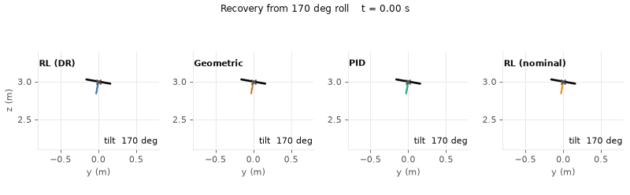
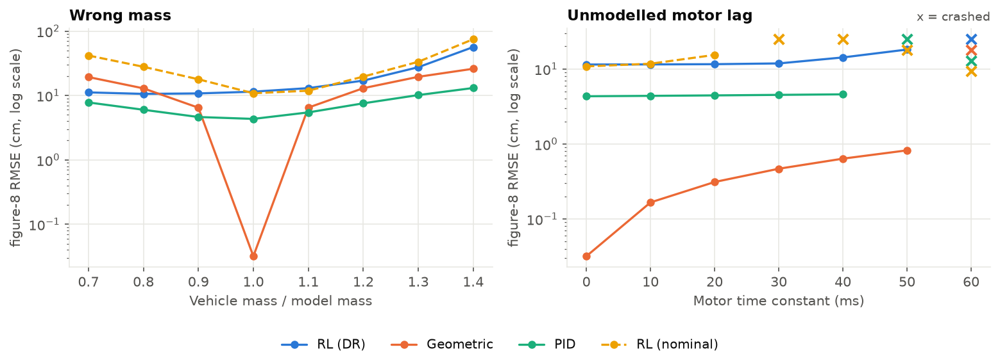
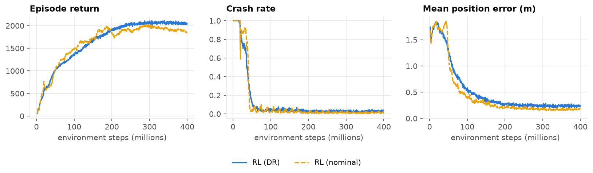

# Quadrotor Control: Reinforcement Learning vs Classical

[](https://github.com/MohnishM21/quadrotor-rl-vs-classical/actions/workflows/tests.yml)

A PPO policy that commands the four rotor thrusts directly, trained from
scratch on a GPU port of my
[quadrotor control benchmark](https://github.com/MohnishM21/quadrotor-control-benchmark).
It is then flown through the same 11 scenarios as PID, LQR, geometric and MPC
controllers. Same simulator, same 200 Hz control rate, same metrics.

<picture>
  <source media="(prefers-color-scheme: dark)" srcset="results/figures/flip_recovery_dark.gif">
  
</picture>

*Recovery from 170° of roll. The domain-randomized policy (RL DR) is upright in
0.2 s and settles in 1.6 s. The policy trained without randomization takes 5 s
to settle.*

## Findings

1. **The policy learned to fly, including from upside down, but tracks far less
   precisely than the model-based controllers.** It settles 3.0 cm from a hover
   target, while LQR, geometric and MPC settle within 0.01 cm. On the figure-8
   its error is 11.5 cm, against 0.03 cm for the geometric controller and
   4.3 cm for PID.
2. **Domain randomization buys robustness, at a cost in precision.** The policy
   trained on the nominal model crashes once the motors lag by 30 ms. The
   randomized one flies with up to 50 ms. With a 30% lighter vehicle, its
   error is 11.2 cm against 41.8 cm. In wind it is 4.5 cm against 8.1 cm.
   The price: in calm hover it settles 3.0 cm off target, against 0.9 cm.
3. **Where RL beats the model-based controllers, it is through robustness.** In
   gusty wind its 4.5 cm beats geometric (5.7), LQR (7.2) and MPC (7.7). Only
   PID, with its integrator, does better (2.3). With a 30% lighter vehicle it
   beats them by about 2 times (11.2 cm against 19.3 to 22.1 cm).
4. **Randomization is not adaptation.** With a heavier vehicle the policy is
   worse than every classical controller: 27.5 cm at 1.3 times the mass,
   against 10.2 cm for PID. Its input includes the same error integral the PID
   uses, but it did not learn to use it the same way. Zeroing that input at
   test time cuts the heavy-vehicle error over the final second from 36 to
   21 cm, while making the wind error worse (4.2 to 5.7 cm). A policy with memory, which can work out
   the mass from recent motion, is the natural next step.
5. **The fast figure-8 (55° tilt) is out of reach.** The randomized policy
   crashes and the nominal one drifts 57 cm. All four classical controllers
   stay under 10 cm.
6. **Inference is cheap.** The two-layer network takes 0.66 ms per step in
   Python on one CPU thread, the same as the geometric controller (0.71 ms)
   and a quarter of MPC (2.74 ms).

## Results

Position RMSE in cm (settling time to within 5 cm for runs that start off the
reference). Classical controllers are from the benchmark repository, unchanged.

| Scenario | PID | LQR | Geometric | MPC | RL (DR) | RL (nominal) |
|---|---:|---:|---:|---:|---:|---:|
| `hover_recovery` | 17.74 (1.38 s) | 19.57 (0.97 s) | 19.77 (0.91 s) | 20.28 (1.01 s) | 22.73 (1.23 s) | 22.03 (1.53 s) |
| `step` | 40.51 (1.30 s) | 43.98 (1.22 s) | 43.17 (1.02 s) | 44.23 (1.25 s) | 54.51 (1.60 s) | 57.94 (1.52 s) |
| `long_step` | 92.56 (0.81 s) | crash | 92.79 (1.18 s) | 102.01 (1.65 s) | 120.45 (1.99 s) | 122.92 (2.09 s) |
| `circle` | 0.93 | <0.01 | <0.01 | <0.01 | 4.09 | 4.22 |
| `figure8` | 4.33 | 0.04 | 0.03 | 0.04 | 11.47 | 10.84 |
| `figure8_fast` | 9.29 | 0.23 | 0.10 | 0.27 | crash | 56.99 |
| `flip_recovery` | 8.14 (1.80 s) | 9.48 (1.05 s) | 23.11 (1.39 s) | 8.12 (1.03 s) | 17.55 (1.58 s) | 27.17 (4.97 s) |
| `mass_mismatch` | 10.16 | 20.85 | 19.51 | 22.32 | 27.50 | 33.38 |
| `motor_lag` | 4.52 | 0.65 | 0.47 | 0.68 | 11.87 | crash |
| `wind` | 2.25 | 7.16 | 5.73 | 7.65 | 4.48 | 8.05 |
| `sensor_noise` | 4.34 | 0.16 | 0.15 | 0.17 | 11.43 | 11.02 |

All metrics are in [`results/benchmark.csv`](results/benchmark.csv) and
[`results/sweeps.csv`](results/sweeps.csv).

<picture>
  <source media="(prefers-color-scheme: dark)" srcset="results/figures/robustness_sweeps_dark.png">
  
</picture>

*Figure-8 error as the real vehicle drifts from the model. The geometric
controller is near perfect at the nominal mass and degrades steadily either
side. The randomized policy is flat from 0.7 to 1.1 times the mass.*

## How it works

**Simulator.** [`torch_dynamics.py`](src/quadrl/torch_dynamics.py) ports the
benchmark's rigid-body model, RK4 integrator and motor model to PyTorch and
steps 16,384 vehicles at once, each with its own mass, inertia, motor lag, drag
and wind. A test checks it against the original simulator to 1e-9 in float64.

**Speed.** One control step launches about 2,000 small GPU kernels. On Windows
that launch overhead, not the arithmetic, set the speed: 70 to 80 ms per step
however many vehicles were simulated. The whole step is therefore written without
data-dependent Python branches (finished episodes reset by masking, not
indexing), recorded once as a CUDA graph, and replayed. That raised throughput
from 0.21 to 2.87 million steps per second, 14 times faster. 400 million
training steps take 13 minutes on a laptop RTX 4060.

**Task.** Every episode draws a random reference (hover, a jump of up to 2 m, or
a multi-axis sinusoid including figure-8 shapes) and a random start up to 1 m
away. 30% of episodes start at a uniformly random attitude, including upside down.

**Policy.** A 256 by 256 MLP maps 28 inputs to 4 rotor thrusts:
- position and velocity error;
- the reference acceleration (the same feedforward the classical controllers get);
- the rotation matrix and body rates;
- an error integral and the previous action.

**Reward.** A survival bonus plus three bonuses that grow as the error shrinks,
with widths of 0.5 m, 10 cm and 2.5 cm, minus small penalties on velocity
error, spin, yaw and jerky motor commands.

**Domain randomization**, per episode:

| Parameter | Range |
|---|---|
| mass | 0.75 to 1.35 times nominal |
| inertia | 0.8 to 1.25 times, per axis |
| motor time constant | 0, or 5 to 40 ms |
| linear drag | 0 to 0.02 N per m/s |
| wind | up to 0.03 N steady, plus gusts |
| sensor noise | up to the benchmark's noise scenario |

**PPO**, written from scratch in [`ppo.py`](src/quadrl/ppo.py):
- GAE, clipped objective and observation normalization;
- reward scaling by the running return std;
- an adaptive learning rate that targets a KL of 0.01;
- bootstrapping of time-limit cuts, so they are not treated as crashes;
- an **asymmetric critic**: during training the critic also sees the true
  mass, inertia, motor lag and wind. The deployed policy never does.

**Evaluation.** [`policy_controller.py`](src/quadrl/policy_controller.py) wraps
the trained network as a benchmark controller. A test flies the same policy in
the training environment and in the benchmark simulator and checks that the
two trajectories agree to 1e-8 m.

<picture>
  <source media="(prefers-color-scheme: dark)" srcset="results/figures/training_curves_dark.png">
  
</picture>

*Each policy is scored in its own training distribution, so the randomized
policy's higher crash rate reflects a harder task.*

## What went wrong first

My first training run crashed in 100% of episodes for 60 million steps. Three
bugs were behind it, found and fixed one at a time:

- **The reward paid the policy to crash.** It subtracted the position error from
  a constant, so far from the target the reward per step was negative and ending
  the episode early scored best. The reward is now positive during any
  controlled flight.
- **PPO measured policy changes that never happened.** I updated the
  observation normalizer during data collection, so the stored action
  probabilities no longer matched the inputs at update time. The KL divergence
  grew even at the smallest learning rate. The normalizer is now frozen within
  each iteration.
- **Every action was paired with the wrong observation.** The CUDA graph
  overwrites the observation buffer in place, and my rollout stored it after
  calling `step()`. [`tests/test_ppo.py`](tests/test_ppo.py) now has a task
  where each observation is fresh noise and the right action copies it. The
  buggy version ends 0.90 off; the test requires under 0.15.
Once it learned, one weakness remained:

- **The first full policy crashed 39% of near-upside-down starts.** One cause
  was that its velocity input was clipped at 3 m/s, so while falling after a
  flip it could not tell how fast it was dropping. I raised the clips to 2 m and
  8 m/s, added the privileged critic, a stronger yaw penalty and the 2.5 cm
  bonus. Near-upside-down crashes fell to 12.5% and the flip scenario went from
  a crash to a recovery. I changed these together, so I cannot say how much
  each contributed.

## Run it

```bash
git clone https://github.com/MohnishM21/quadrotor-rl-vs-classical.git
cd quadrotor-rl-vs-classical
python -m venv .venv
source .venv/bin/activate                 # Windows: .venv\Scripts\activate
pip install torch --index-url https://download.pytorch.org/whl/cu128   # or the CPU build
pip install -e ".[dev]"                   # also installs the benchmark package
pytest                                    # 15 tests, under a minute
python scripts/evaluate.py                # all scenarios and sweeps, about 2 min
python scripts/train.py --name ppo_dr     # retrain, about 13 min on an RTX 4060
python scripts/train.py --name ppo_nominal --no-dr
```

The trained policies are included in [`models/`](models), so evaluation does
not need a GPU.

## Layout

```
src/quadrl/
├── torch_dynamics.py    batched rigid-body dynamics, a port of the benchmark's model
├── env.py               random tasks, domain randomization, reward, CUDA-graph step
├── observation.py       policy inputs and action mapping, shared by training and evaluation
├── ppo.py               PPO with asymmetric critic and adaptive learning rate
├── policy_controller.py the trained policy as a benchmark controller
└── plotting.py          figures and GIF
scripts/                 train.py, evaluate.py
tests/                   simulator parity, environment, PPO and end-to-end checks
models/                  ppo_dr.pt, ppo_nominal.pt
```

## Limitations and next steps

- One training seed per policy. Differences of a few centimetres between the
  two policies may not hold across seeds.
- The policy commands rotor thrusts directly. Commanding collective thrust and
  body rates, as most flight stacks do, would likely track better.
- A policy with memory (a recurrent network, or an adaptation module as in
  RMA) should fix the heavy-vehicle result by estimating mass online.
- Simulation only. The model approximates a Crazyflie 2.x, so a Crazyflie is
  the natural hardware test.

## References

- J. Schulman et al., *Proximal Policy Optimization Algorithms*, 2017.
- L. Pinto et al., *Asymmetric Actor Critic for Image-Based Robot Learning*, RSS 2018.
- J. Tobin et al., *Domain Randomization for Transferring Deep Neural Networks from Simulation to the Real World*, IROS 2017.
- A. Kumar et al., *RMA: Rapid Motor Adaptation for Legged Robots*, RSS 2021.
- J. Eschmann, D. Albani, G. Loianno, *Learning to Fly in Seconds*, IEEE RA-L 2024.
- N. Rudin et al., *Learning to Walk in Minutes Using Massively Parallel Deep Reinforcement Learning*, CoRL 2021.

## License

MIT
